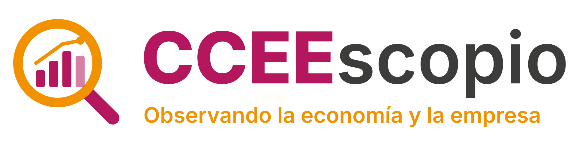

::: {.hero}
{.hero-logo fig-alt="CCEEscopio. Observando la economía y la empresa"}

**CCEEscopio** es el **observatorio de indicadores económicos y empresariales** de la [Facultad de Ciencias Económicas y Empresariales](https://fccee.ugr.es/) de la Universidad de Granada. Reúne en un solo lugar los principales datos de la economía y la empresa (precios, empleo, actividad, innovación, turismo, finanzas públicas, desigualdad y sostenibilidad) para España, Andalucía y los países de la Unión Europea.

<p class="tagline">Datos oficiales, actualizados y descargables, al servicio de la **docencia** y la **investigación** de la Facultad.</p>
:::

## CCEEscopio en un minuto

```{=html}
<div class="video-wrap">
<video controls preload="metadata" playsinline poster="media/cceescopio_video_portada.jpg">
  <source src="media/cceescopio_video.mp4" type="video/mp4">
  Tu navegador no puede reproducir este vídeo. <a href="media/cceescopio_video.mp4">Descárgalo aquí</a>.
</video>
</div>
```

## ¿Qué encontrarás?

::: {.cards}
[<span class="icon">🛒</span><h3>Precios e inflación</h3><p>IPCA general, alimentos, energía y servicios; precios de la vivienda.</p>](precios.qmd){.card-ccee}

[<span class="icon">👥</span><h3>Mercado laboral</h3><p>Paro total, juvenil y femenino; tasa de empleo; paro por comunidades.</p>](empleo.qmd){.card-ccee}

[<span class="icon">📈</span><h3>Actividad y coyuntura</h3><p>PIB, PIB per cápita, producción industrial, comercio y sentimiento económico.</p>](actividad.qmd){.card-ccee}

[<span class="icon">💡</span><h3>Empresa e innovación</h3><p>I+D, empresas que usan inteligencia artificial, comercio electrónico y confianza industrial.</p>](empresa.qmd){.card-ccee}

[<span class="icon">✈️</span><h3>Turismo</h3><p>Viajeros y pernoctaciones en hoteles, residentes y extranjeros, por regiones.</p>](turismo.qmd){.card-ccee}

[<span class="icon">🏛️</span><h3>Sector público y mercados</h3><p>Deuda y déficit públicos, bono a 10 años y tipo de cambio euro/dólar.</p>](publico.qmd){.card-ccee}

[<span class="icon">⚖️</span><h3>Desigualdad</h3><p>Gini, S80/S20 y riesgo de pobreza o exclusión social, también por comunidades.</p>](desigualdad.qmd){.card-ccee}

[<span class="icon">🌱</span><h3>Energía y sostenibilidad</h3><p>Energías renovables, precio de la electricidad y emisiones.</p>](sostenibilidad.qmd){.card-ccee}

[<span class="icon">🗺️</span><h3>Andalucía y regiones</h3><p>Andalucía frente al resto de comunidades autónomas y la UE.</p>](andalucia.qmd){.card-ccee}

[<span class="icon">🏆</span><h3>Rankings</h3><p>La UGR en Economía, Empresa, Finanzas, Estadística y Turismo.</p>](rankings.qmd){.card-ccee}
:::

## Una herramienta para la docencia y la investigación

::: {.uses}
::: {.use-box}
### Docencia

- Datos reales y actualizados para las clases de **Economía, Empresa, Estadística, Econometría, Finanzas y Turismo**.
- Gráficos interactivos para explicar conceptos (inflación, ciclo económico, convergencia regional, desigualdad).
- Material para prácticas, **TFG y TFM**, con datos listos para descargar.
- [Ideas de uso en asignaturas](docencia.qmd)
:::

::: {.use-box}
### Investigación

- **Descarga de los datos en CSV** de cada gráfico, con su fuente y unidad, para usarlos en artículos, tesis y proyectos.
- Series oficiales y homogéneas de Eurostat, comparables entre países y regiones.
- Enlaces a microdatos y fuentes especializadas (INE, Banco de España, IECA, Banco Mundial).
- [Datos y fuentes](datos.qmd)
:::
:::

## Datos siempre actualizados

Los indicadores se **descargan en directo de la API de Eurostat** cada vez que se abre una página, de modo que muestran siempre la última publicación oficial. Cada gráfico permite elegir los territorios que se comparan (España, Andalucía, comunidades autónomas y países de la UE), consultar los valores pasando el ratón y **descargar los datos** en CSV.

## Quién lo gestiona

CCEEscopio es una iniciativa de la **Facultad de Ciencias Económicas y Empresariales** de la Universidad de Granada, gestionada por el **Vicedecanato de Investigación, Transferencia y Posgrado**. Si quieres proponer nuevos indicadores, colaborar o comunicar un error, escríbenos a [investiga_ccee@ugr.es](mailto:investiga_ccee@ugr.es).

::: {.logos-inst}
{fig-alt="Universidad de Granada y Facultad de Ciencias Económicas y Empresariales"}
:::
