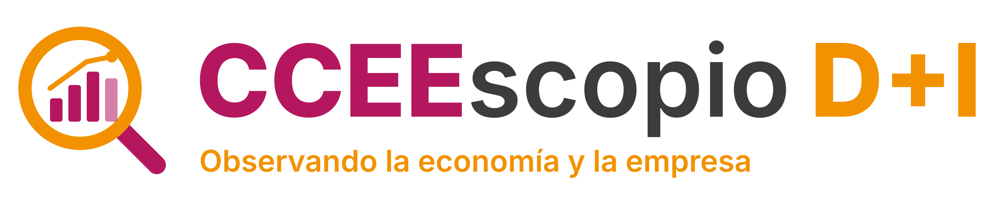
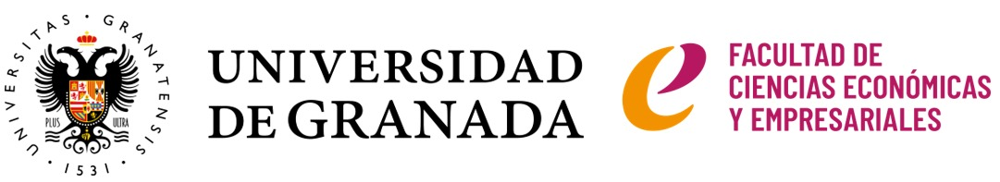

::: {.hero}
{.hero-logo fig-alt="CCEEscopio D+I. Observando la economía y la empresa"}

**CCEEscopio D+I** (Docencia + Investigación) es el **observatorio de indicadores económicos y empresariales** de la [Facultad de Ciencias Económicas y Empresariales](https://fccee.ugr.es/) de la Universidad de Granada. Reúne en un solo lugar **99 indicadores** de la economía y la empresa (precios, empleo, actividad, empresa e innovación, turismo, sector público y mercados financieros, desigualdad y pobreza, sostenibilidad, población y economía internacional) para España, Andalucía y los países de la Unión Europea.

<p class="tagline">Observatorio de indicadores económicos y empresariales al servicio de la **Docencia** y la **Investigación**</p>

<p class="visitas-ccee" hidden>👁️ <span class="vc-num"></span> visitas a CCEEscopio</p>
:::

## Hoy en la economía {#hoy}

```{=html}
<div class="hoy-cab"><span class="hoy-fecha" id="hoy-fecha"></span><span class="hoy-act" id="hoy-act"></span></div>
<div class="ticker" id="hoy-bolsa" aria-label="Cotizaciones"></div>
<p class="nota" id="hoy-bolsa-nota"></p>
<div class="hoy-bloques" id="hoy-noticias"><p class="hoy-vacio">Cargando las noticias del día…</p></div>
<p class="nota">Las noticias más destacadas de las últimas 24 horas (las que publican más medios), seleccionadas cada mañana antes de las 9:00 a partir de Google Noticias. Los titulares enlazan a la noticia original y las etiquetas, a los indicadores de CCEEscopio con los que puedes comprobarlas. Más noticias en <a href="noticias.html">Noticias e indicadores</a>; todas las cotizaciones en <a href="bolsa.html">Bolsa al día</a>.</p>
<script>
(async function () {
  const C = window.CCEE, $ = (id) => document.getElementById(id);
  const hoyTxt = new Date().toLocaleDateString("es-ES", {weekday: "long", day: "numeric", month: "long", year: "numeric"});
  $("hoy-fecha").textContent = hoyTxt.charAt(0).toUpperCase() + hoyTxt.slice(1);
  // cotizaciones
  C.rama("bolsa", "bolsa-resumen.json").then(b => {
    if (!b) { $("hoy-bolsa").remove(); return; }
    const ids = ["ibex35", "eurostoxx50", "dax", "sp500", "nasdaq", "nikkei", "brent", "oro"];
    const S = ids.map(id => b.series.find(s => s.id === id)).filter(Boolean);
    $("hoy-bolsa").innerHTML = S.map(s => {
      const cl = s.d1 > 0 ? "sube" : s.d1 < 0 ? "baja" : "";
      const nom = s.nombre.replace(/ \(.*\)$/, "");
      return `<a class="tick" href="bolsa.html" title="${C.esc(s.nombre)} · cierre del ${C.fecha(s.fecha + "T12:00", {day: "numeric", month: "long"})}">
        <span class="tick-n">${C.esc(nom)}</span><span class="tick-v">${C.num(s.valor, s.valor < 1000 ? 2 : 0)}</span><span class="tick-d ${cl}">${s.d1 > 0 ? "▲" : s.d1 < 0 ? "▼" : ""} ${C.pct(s.d1, 2, true)}</span>${C.spark(s.spark, {w: 120, h: 24})}</a>`;
    }).join("");
    $("hoy-bolsa-nota").textContent = `Último cierre disponible y variación diaria. Cotizaciones actualizadas el ${new Date(b.actualizado * 1000).toLocaleString("es-ES", {day: "numeric", month: "long", hour: "2-digit", minute: "2-digit"})} (fuente: ${b.fuente}).`;
  });
  // noticias del día
  const d = await C.rama("portada", "portada.json");
  if (!d) { $("hoy-noticias").innerHTML = `<p class="hoy-vacio">Las noticias del día todavía no están disponibles. Mientras tanto, consulta <a href="noticias.html">Noticias e indicadores</a>.</p>`; return; }
  const act = new Date(d.actualizado * 1000);
  const esHoy = act.toDateString() === new Date().toDateString();
  $("hoy-act").textContent = (esHoy ? "Noticias seleccionadas hoy a las " + act.toLocaleTimeString("es-ES", {hour: "2-digit", minute: "2-digit"}) : "Noticias del " + C.fecha(act, {weekday: "long", day: "numeric", month: "long"}));
  const hace = ts => { const h = (Date.now() / 1000 - ts) / 3600; return h < 1 ? "hace menos de una hora" : h < 24 ? `hace ${Math.round(h)} h` : C.fecha(ts * 1000, {day: "numeric", month: "short"}); };
  const icono = {espana: "🇪🇸", europa: "🇪🇺", mundo: "🌍"};
  $("hoy-noticias").innerHTML = d.bloques.map(b => `<div class="hoy-bloque"><h3>${icono[b.id] || ""} ${C.esc(b.titulo)}</h3>${b.noticias.length ? `<ol>${b.noticias.map(n => `
    <li><a class="hoy-t" href="${C.esc(n.url)}" target="_blank" rel="noopener">${C.esc(n.t)}</a>
      <span class="hoy-m">${C.esc(n.fuente)} · ${hace(n.ts)}${n.medios > 1 ? ` · en ${n.medios} medios` : ""}</span>
      ${(n.ind.length || n.bolsa) ? `<div class="hoy-ind">${n.ind.map(i => d.indicadores[i] ? `<a href="${d.indicadores[i].pagina}.html?i=${i}">📊 ${C.esc(d.indicadores[i].nombre)}</a>` : "").join("")}${n.bolsa ? `<a href="bolsa.html">📈 Bolsa al día</a>` : ""}</div>` : ""}
    </li>`).join("")}</ol>` : `<p class="hoy-vacio">Sin noticias destacadas en las últimas horas.</p>`}</div>`).join("");
  document.querySelectorAll("#hoy-noticias a.hoy-t").forEach(a => a.addEventListener("click", () => C.evento("inicio/noticia", "Inicio: noticia del día")));
})();
</script>
```

## CCEEscopio D+I en vídeo

```{=html}
<div class="video-wrap">
<video controls preload="metadata" playsinline poster="media/cceescopio_video_portada.jpg">
  <source src="media/cceescopio_video.mp4" type="video/mp4">
  Tu navegador no puede reproducir este vídeo. <a href="media/cceescopio_video.mp4">Descárgalo aquí</a>.
</video>
</div>
```

## ¿Qué encontrarás?

::: {.cards}
[<span class="icon">🛒</span><span class="ct">Precios e inflación</span><span class="cd">IPCA general, alimentos, energía y servicios; precios de la vivienda.</span>](precios.qmd){.card-ccee}

[<span class="icon">👥</span><span class="ct">Mercado laboral</span><span class="cd">Paro total, juvenil y femenino; tasa de empleo; paro por comunidades.</span>](empleo.qmd){.card-ccee}

[<span class="icon">📈</span><span class="ct">Actividad y coyuntura</span><span class="cd">PIB, PIB per cápita, producción industrial, comercio y sentimiento económico.</span>](actividad.qmd){.card-ccee}

[<span class="icon">💡</span><span class="ct">Empresa e innovación</span><span class="cd">I+D, empresas que usan inteligencia artificial, comercio electrónico y confianza industrial.</span>](empresa.qmd){.card-ccee}

[<span class="icon">✈️</span><span class="ct">Turismo</span><span class="cd">Viajeros y pernoctaciones en hoteles, residentes y extranjeros, por regiones.</span>](turismo.qmd){.card-ccee}

[<span class="icon">🏛️</span><span class="ct">Sector público y mercados</span><span class="cd">Deuda y déficit públicos, bono a 10 años y tipo de cambio euro/dólar.</span>](publico.qmd){.card-ccee}

[<span class="icon">⚖️</span><span class="ct">Desigualdad y pobreza</span><span class="cd">Gini, S80/S20, riesgo de pobreza, umbral de pobreza, pobreza infantil y laboral, carencia material y vivienda.</span>](desigualdad.qmd){.card-ccee}

[<span class="icon">🌱</span><span class="ct">Energía y sostenibilidad</span><span class="cd">Energías renovables, precio de la electricidad y emisiones.</span>](sostenibilidad.qmd){.card-ccee}

[<span class="icon">👪</span><span class="ct">Población, educación y salud</span><span class="cd">Población, fecundidad, envejecimiento, esperanza de vida y capital humano.</span>](poblacion.qmd){.card-ccee}

[<span class="icon">🌍</span><span class="ct">Economía internacional</span><span class="cd">Exportaciones, balanza por cuenta corriente, inversión internacional y convergencia con la UE.</span>](internacional.qmd){.card-ccee}

[<span class="icon">🗺️</span><span class="ct">Andalucía y regiones</span><span class="cd">Andalucía frente al resto de comunidades autónomas y la UE.</span>](andalucia.qmd){.card-ccee}

[<span class="icon">🏆</span><span class="ct">La Facultad en los ranking</span><span class="cd">La UGR en Economía, Empresa, Finanzas y Turismo.</span>](rankings.qmd){.card-ccee}
:::

## Herramientas

::: {.cards}
[<span class="icon">🧮</span><span class="ct">Calculadora de inflación</span><span class="cd">¿Cuánto valen hoy los euros de otro año?</span>](calculadora.qmd){.card-ccee}

[<span class="icon">🪪</span><span class="ct">Ficha de país o región</span><span class="cd">Los indicadores clave de un territorio de un vistazo.</span>](ficha.qmd){.card-ccee}

[<span class="icon">🔗</span><span class="ct">Relaciona dos indicadores</span><span class="cd">Curva de Phillips, ley de Okun y otras relaciones entre países.</span>](relaciona.qmd){.card-ccee}

[<span class="icon">🔎</span><span class="ct">Buscador de indicadores</span><span class="cd">Los 99 indicadores de CCEEscopio en una tabla.</span>](indicadores.qmd){.card-ccee}
:::

## Simuladores con datos reales {#simuladores}

Toma decisiones y observa sus consecuencias. Cada simulador parte de los **últimos datos publicados** y enlaza con los indicadores de CCEEscopio. [Ver todos los simuladores](simuladores.qmd).

::: {.cards}
[<span class="icon">🏦</span><span class="ct">Gobernador del Banco Central</span><span class="cd">Fija los tipos de interés durante ocho trimestres y controla la inflación sin provocar una recesión.</span>](sim-banco-central.qmd){.card-ccee}

[<span class="icon">💼</span><span class="ct">Gestiona una cartera</span><span class="cd">Invierte 100.000 € en un periodo secreto de la historia de la bolsa y descubre su rentabilidad y su riesgo.</span>](sim-cartera.qmd){.card-ccee}

[<span class="icon">💶</span><span class="ct">Llega a fin de mes</span><span class="cd">Gestiona el presupuesto de un hogar durante un año con la inflación real de cada tipo de gasto.</span>](sim-fin-de-mes.qmd){.card-ccee}

[<span class="icon">🏖️</span><span class="ct">Gestiona tu destino turístico</span><span class="cd">Precios, plazas, promoción y tasa turística: rentabilidad, empleo, vivienda y sostenibilidad.</span>](sim-turismo.qmd){.card-ccee}
:::

## Para cada asignatura de la Facultad

En [**Docencia**](docencia.qmd) encontrarás, **por grados (GADE, GECO, GFICO, GMIM y GTUR) y asignaturas**, los indicadores recomendados y ejemplos de uso en clase.

## Una herramienta para la docencia y la investigación

::: {.uses}
::: {.use-box}
### Docencia

- Datos reales y actualizados para las clases de **Economía, Empresa, Métodos Cuantitativos, Econometría, Finanzas y Turismo**, con indicadores y ejemplos [por grados y asignaturas](docencia.qmd).
- Gráficos interactivos, calculadoras y un [laboratorio de números índice](numeros-indice.qmd) para explicar conceptos.
- [Juegos para clase](juegos.qmd) con código QR y ranking en directo, [ejercicios autocorregibles](ejercicios.qmd) y un [generador de exámenes](examen.qmd).
:::

::: {.use-box}
### Investigación

- [Ideas para TFG y TFM](ideas-tfg.qmd) con pregunta, hipótesis, datos y método, y un [generador de gráficos](graficos.qmd) que da la cita de la fuente.
- **Descarga de los datos en CSV** y de los gráficos en PNG o SVG, con su fuente y unidad, para artículos, tesis y proyectos.
- Análisis avanzados: [mapa de calor de coyuntura](coyuntura.qmd), [desigualdad con Gini y Theil](desigualdad-calc.qmd), [convergencia](convergencia.qmd) y [regresión](regresion.qmd).
- [La Facultad en los ranking](rankings.qmd) y [datos y fuentes](datos.qmd) (INE, Banco de España, IECA, Banco Mundial).
:::
:::

## Datos siempre actualizados

Los indicadores se **descargan en directo de la API de Eurostat** cada vez que se abre una página, de modo que muestran siempre la última publicación oficial. Cada gráfico permite elegir los territorios que se comparan (España, Andalucía, comunidades autónomas y países de la UE), consultar los valores pasando el ratón y **descargar los datos** en CSV.

## Novedades

- **Nuevo · [Hoy en la economía](#hoy)** <span class="badge-nuevo">nuevo</span>: cada mañana, antes de las 9:00, la portada muestra las noticias económicas y empresariales más destacadas del día en España, Europa y el mundo, con los indicadores de CCEEscopio para comprobarlas, y las últimas cotizaciones de las bolsas.
- **Nuevo · [Bolsa al día](bolsa.qmd)** <span class="badge-nuevo">nuevo</span>: el IBEX 35, el Euro Stoxx 50, Wall Street, Asia, el petróleo, el oro y las grandes empresas del IBEX, actualizados tres veces al día, con gráficos comparados en base 100, rentabilidades, volatilidad y retos que los relacionan con los indicadores económicos.
- **Nuevo · [Simuladores](simuladores.qmd)** <span class="badge-nuevo">nuevo</span>: [Gobernador del Banco Central](sim-banco-central.qmd), [Gestiona una cartera](sim-cartera.qmd), [Llega a fin de mes](sim-fin-de-mes.qmd) y [Gestiona tu destino turístico](sim-turismo.qmd), con datos reales de Eurostat y de las bolsas.

- **Nuevo · [Piedra, papel o tijera](ppt.qmd)** <span class="badge-nuevo">nuevo</span>: juego para clase con código QR. El profesorado elige cuántas preguntas hay que superar; cada acierto da una partida contra la aplicación (si ganas, pasas de pregunta; si empatas, vuelves a jugar; si pierdes, contestas otra pregunta). Gana quien antes las supere todas.
- **Nuevo · [Detecta el engaño](detecta-engano.qmd)** <span class="badge-nuevo">nuevo</span>: seis pares de gráficos con datos reales de Eurostat, uno honesto y otro engañoso. Descubre cuál engaña y qué truco usa: ejes cortados, fechas a medida, euros sin deflactar, bases de índice interesadas…
- **Nuevo · [Plantilla de informe de coyuntura](informe-coyuntura.qmd)** <span class="badge-nuevo">nuevo</span>: genera en un clic el esqueleto de un informe con los últimos datos del país que elijas, descárgalo en Word y evalúalo con la rúbrica incluida.
- **Actualizado · [La Facultad en los ranking](rankings.qmd)**: añadida la edición 2024 del Ranking de Shanghái por materias y completadas las series con la web oficial de ShanghaiRanking.
- **Nuevo · Tres juegos más para clase con código QR** <span class="badge-nuevo">nuevo</span>: [Bingo de indicadores](bingo.qmd) (tacha los países que cumplen cada condición), [Ordena la malla](ordena.qmd) (de mayor a menor) y [¿Quién es quién?](quien.qmd) (adivina el país por sus indicadores).
- **Nuevo · [Mapa de calor de coyuntura](coyuntura.qmd)** <span class="badge-nuevo">nuevo</span>: todos los países de la UE (o las comunidades autónomas) y sus principales indicadores de un vistazo, coloreados según su posición relativa.
- **Nuevo · [Laboratorio de números índice](numeros-indice.qmd)** <span class="badge-nuevo">nuevo</span>: cambio de base, tasas de variación, enlace de series, deflactación y los índices de Laspeyres, Paasche y Fisher, con datos reales y ejercicios autocorregibles.
- **Nuevo · [Ideas para tu TFG o TFM](ideas-tfg.qmd)** <span class="badge-nuevo">nuevo</span>: un generador de temas de investigación con pregunta, hipótesis, datos, método y estructura, para todas las titulaciones de la Facultad.
- **Rankings en gráficos**: la posición de la UGR en los rankings por disciplinas, ahora también [en gráficos](rankings.qmd#en-graficos).
- **Nuevo · [Memoria de datos](memoria.qmd)** <span class="badge-nuevo">nuevo</span>: juego para clase con código QR. Durante unos segundos se proyecta una malla 3 × 3 con el dato de un indicador en nueve países o comunidades autónomas; después se ocultan y, desde el móvil, cada acierto descubre una casilla y cada fallo obliga a empezar de nuevo. Gana quien antes desbloquee las nueve.
- **Nuevo · [Precios de productos](precios-productos.qmd)** <span class="badge-nuevo">nuevo</span>: la gasolina y el gasóleo cada semana desde 2005, con la parte que son impuestos y comparados con el IPC (también en euros de hoy); el precio de la luz y el gas de los hogares; y cuánto costaban el pan, la leche, el aceite o el café en cualquier fecha.
- **Nuevo · Concurso [«¿Cuánto costaba?»](concurso-precios.qmd)** <span class="badge-nuevo">nuevo</span>: los estudiantes ven un producto con su precio actual y, desde el móvil, adivinan cuánto costaba en una fecha del pasado. Gana quien más se acerque.
- **Nuevo · Mapas animados** <span class="badge-nuevo">nuevo</span>: en todos los paneles temáticos, el mapa se puede animar para ver cómo cambia cada indicador a lo largo del tiempo, con la misma escala de colores en todos los periodos. Puedes pararlo en cualquier momento o seguir eligiendo un periodo concreto.
- **Nuevo · [Concurso en clase](concurso.qmd)** <span class="badge-nuevo">nuevo</span>: los estudiantes escanean un QR, responden preguntas con datos reales desde el móvil y el ranking aparece en directo en la pantalla.
- **Nuevo · Guarda cualquier gráfico** <span class="badge-nuevo">nuevo</span>: todos los gráficos tienen botones para descargarlos en PNG de alta resolución o en SVG, con su leyenda y la fuente, listos para un trabajo, un TFG o un TFM.
- **Nuevo · [Calculadoras](calculadoras.qmd)** <span class="badge-nuevo">nuevo</span>: un menú con todas las calculadoras y dos nuevas, la [regresión con análisis de supuestos](regresion.qmd) y el [análisis cuantitativo de datos](estadistica.qmd), que funcionan con las series de CCEEscopio o con tus propios datos.
- **Nuevo · [Pirámides de población](piramides.qmd)** <span class="badge-nuevo">nuevo</span>: de los países europeos, las comunidades autónomas y las provincias, con animación desde el año 2000.
- **Nuevo · [¿Qué explica cada indicador?](descomposiciones.qmd)** <span class="badge-nuevo">nuevo</span>: descompón la inflación (alimentos, energía, vivienda, transporte, servicios…), el crecimiento del PIB, la cuenta corriente, la población y el turismo, y descubre qué componentes explican cada subida.
- **Nuevo · [Noticias e indicadores](noticias.qmd)** <span class="badge-nuevo">nuevo</span>: noticias económicas de los últimos días con el reto de comprobarlas con los indicadores de CCEEscopio.
- **Nuevo · 🎮 [Juegos con datos](juegos.qmd)** <span class="badge-nuevo">nuevo</span>: el dato del día, ¿más alto o más bajo?, adivina el país, ¿qué pasó aquí?, ordena los países y un **modo aula** para competir en clase. Y además, [predice el próximo dato](prediccion.qmd).
- **Nuevo · Para el profesorado** <span class="badge-nuevo">nuevo</span>: [generador de exámenes y fichas de práctica](examen.qmd) con versiones, soluciones y exportación a PRADO, [exámenes de Técnicas Cuantitativas III](examen-tc3.qmd) con soluciones, y [modo presentación](presentacion.qmd) para proyectar en clase.
- **Nuevo · Análisis** <span class="badge-nuevo">nuevo</span>: [datos extremos e inusuales](extremos.qmd), [ciclo económico y semáforo de coyuntura](ciclo.qmd), [convergencia σ y β](convergencia.qmd), [qué indicador se adelanta](desfases.qmd), [previsión sencilla](prevision.qmd), [calculadora de desigualdad](desigualdad-calc.qmd) y [simulador de política fiscal](politica-fiscal.qmd).
- **Para estudiar y enseñar**: [ejercicios autocorregibles](ejercicios.qmd) con los últimos datos, [generador de gráficos para el TFG](graficos.qmd) con la cita en APA y [glosario de indicadores](glosario.qmd).
- **Herramientas**: [simulador de hipotecas y préstamos](hipoteca.qmd) con el euríbor real, [conversor de unidades](conversor.qmd) y [comparador de comunidades autónomas](comparador.qmd).
- **Paneles**: [mercados al día](mercados.qmd), [turismo en Andalucía](turismo-andalucia.qmd), [demografía empresarial](empresas.qmd) y [consumo y confianza](consumo.qmd).
- **Al día**: [boletín de coyuntura](boletin.qmd), [datos recientes y calendario](calendario.qmd) y [bases de datos de la Biblioteca](biblioteca.qmd).

## Tu opinión cuenta

¿Te resulta útil CCEEscopio? Responde a la [**encuesta de satisfacción**](encuesta.qmd): es anónima y se contesta en menos de un minuto. También puedes abrirla desde el botón **⭐ ¿Nos valoras?** que aparece en todas las páginas.

## Quién lo gestiona

CCEEscopio es una iniciativa de la **Facultad de Ciencias Económicas y Empresariales** de la Universidad de Granada, gestionada por el **Vicedecanato de Investigación, Transferencia y Posgrado**. Si quieres proponer nuevos indicadores, colaborar o comunicar un error, escríbenos a [investiga_ccee@ugr.es](mailto:investiga_ccee@ugr.es).

::: {.logos-inst}
{fig-alt="Universidad de Granada y Facultad de Ciencias Económicas y Empresariales"}
:::
